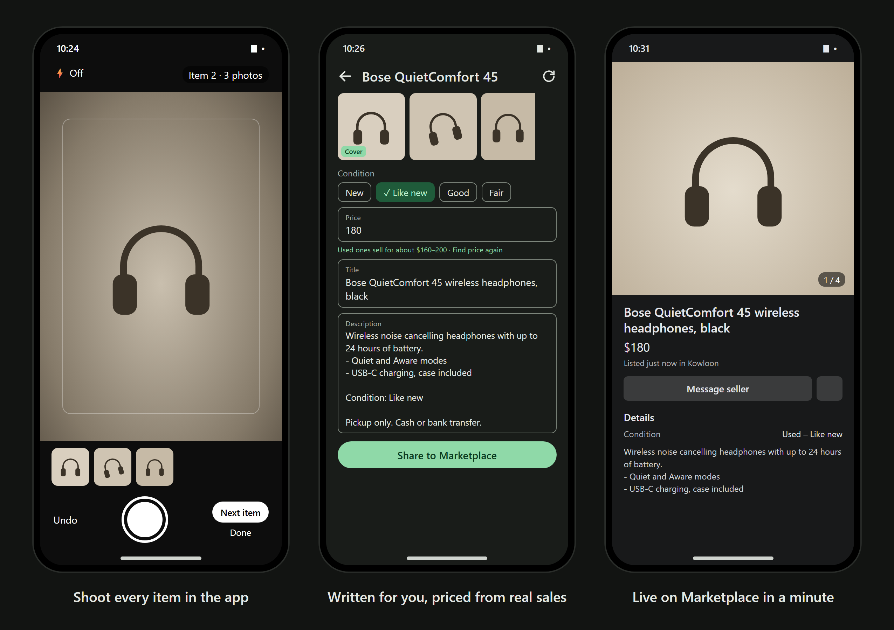

# Listing Prep

Turn a pile of photos into ready-to-post Facebook Marketplace listings, entirely on your Android phone.

## What it does

- **Built-in camera.** Shoot every angle of one item, tap *Next item*, repeat. Each group becomes an item, with no gallery picking. Photos stay inside the app.
- **Or sorts existing photos.** *From gallery* lets you pick photos; on-device image matching groups them into items and picks the sharpest as the cover.
- **Tracks what's sold.** Items move from *To post* to *Posted* to *Sold*. Delete a sold item and its photos go too: in-app shots, the copies made for Facebook and, if you choose, the gallery originals.
- **Writes the listing.** Gemma 3n runs on the phone, reads brand names and labels from the photos, and writes a title and description. Nothing is uploaded.
- **You check it.** Each item has a *Checked* switch; sharing stays locked until you've reviewed the photos and text.
- **Posts it fast.** *Share to Marketplace* saves the photos cover-first, opens Facebook, and shows a floating panel with one-tap copy buttons for the title and description. *Done* marks the item posted.

## Install

1. On your phone, open the [latest release](https://github.com/JackLongman12/marketplace-listing-prep/releases/latest) and download `ListingPrep-N.apk`.
2. Open it and allow installs from your browser when Android asks.
3. In the app, go to **Settings → AI model** for the one-time model setup (free, 4.4 GB, Wi-Fi).

Built and tested for the Galaxy S26 Ultra (Android 13+, 64-bit ARM, 8 GB+ RAM recommended).

## Privacy

Photos, items and AI processing stay on the phone. The app can only connect to huggingface.co, to start the model download; all other connections are blocked. Shared photos carry no location data. See [SECURITY.md](SECURITY.md) for details and how to report a problem.

## Build from source

GitHub Actions builds and signs every push to `main` (see `.github/workflows/build.yml`). To build locally, open the project in Android Studio, or run `gradle assembleDebug` with JDK 17 and the Android SDK.
